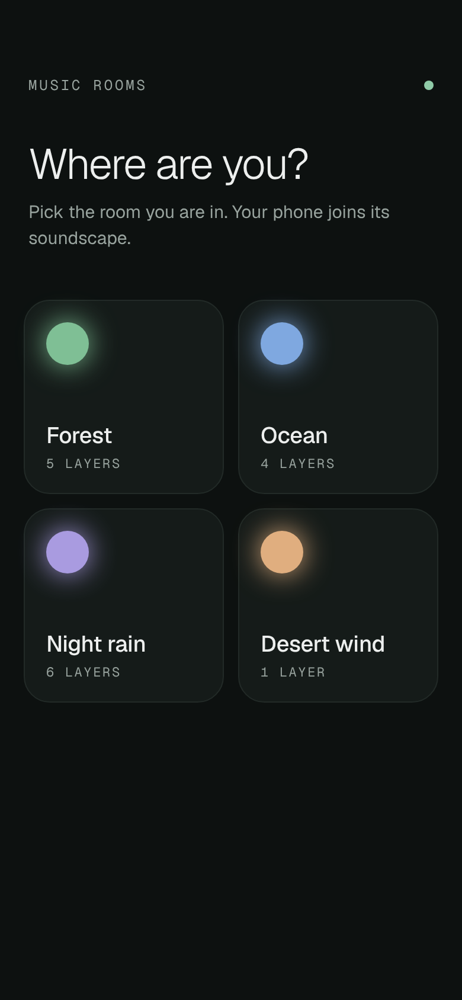
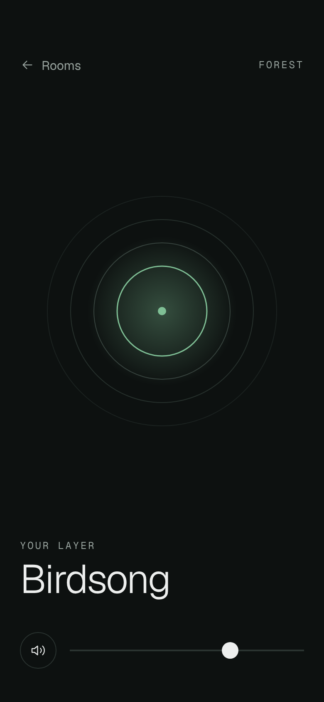

# Visual style

The look of the visitor app, agreed with the product owner: dark, modern, clean and minimal. The room selection page follows the "Glow" direction (rounded cards, each with a glowing dot in the room's colour) and the room page the "Mono" direction (thin concentric rings, the layer name in large light type), unified by one background, one type family and the room's colour.

| Room selection | Room page |
| --- | --- |
|  |  |

The mockups are plain HTML and CSS: [`mockups/room-selection.html`](mockups/room-selection.html), [`mockups/room.html`](mockups/room.html), with the tokens below in [`mockups/tokens.css`](mockups/tokens.css). Open them in a browser at phone width. They are the reference for values; the room names, layer names and counts in them are examples.

## Tokens

### Colour

| Token | Value | Use |
| --- | --- | --- |
| `--bg` | `#0d1110` | Page background (green-tinted near black) |
| `--surface` | `#151b19` | Cards |
| `--surface-raised` | `#222a27` | Buttons and fields on a surface |
| `--border` | `#222a27` | Card borders |
| `--border-strong` | `#2a3330` | Hover borders, icon button outline, slider track |
| `--text` | `#edefee` | Primary text |
| `--text-muted` | `#98a39e` | Secondary text and labels (7:1 on `--bg`) |
| `--accent` | `#8fcba8` | App accent: the brand dot, focus details |
| `--ring-1`…`--ring-3` | `#1b2220`, `#26302c`, `#36423d` | Room page rings, outermost to inner |

There is no light theme; the app is dark everywhere, including the staff area.

### Room palette

Each room has a colour (see Room colour below), picked from this fixed palette, in this order:

| # | Name | Value |
| --- | --- | --- |
| 1 | Moss | `#7fbf95` |
| 2 | Sky | `#7fa8e0` |
| 3 | Lavender | `#a99be0` |
| 4 | Sand | `#e0ae7f` |
| 5 | Coral | `#e08a84` |
| 6 | Teal | `#6cc4c0` |
| 7 | Gold | `#d9c46a` |
| 8 | Rose | `#d98fb8` |

Room colours are decoration (the dot, the rings); never put text in a room colour, and never rely on colour alone to tell rooms apart (the name is always shown).

### Type

- **Geist** (sans) for everything, **Geist Mono** for small labels. Self-host them or load them from Google Fonts; fall back to `system-ui` / `ui-monospace`.
- Page title: 36px, weight 300, letter-spacing -0.03em, line-height 1.05.
- Layer name (room page): 48px, weight 300, letter-spacing -0.03em, line-height 1.
- Room card name: 19px, weight 500, letter-spacing -0.01em.
- Body: 15px, weight 400, line-height 1.5, `--text-muted` for supporting copy.
- Label: Geist Mono 12px, uppercase, letter-spacing 0.16em, `--text-muted` ("MUSIC ROOMS", "YOUR LAYER", the room name on the room page). The layer count on a card is the same at 11px and 0.12em.

### Shape and spacing

- Card radius 22px, 1px border; round icon buttons; 2px slider track with a 20px round thumb.
- Touch targets at least 44px.
- Page side padding 20px (selection) and 24px (room page); 12px gap between cards.
- Focus: a visible 2px `--text` outline with 2px offset on `:focus-visible` for every link and control.

## Screens

### Room selection (`/`)

- Header: the "MUSIC ROOMS" label with an 8px `--accent` dot at the right.
- Title "Where are you?" and one line of supporting copy.
- A grid of room cards: two columns on a phone, more on wider screens (`repeat(auto-fill, minmax(160px, 1fr))`, content max-width 960px).
- Each card is one link, 164px tall: a 36px dot in the room's colour with a soft glow (`box-shadow: 0 0 24px <colour>`) at the top, and at the bottom the room name and its layer count ("1 layer", "5 layers"; "No layers yet" for an empty room).
- Loading, error and empty states use the same title and body styles; the error keeps its retry action as a button.

### Room page (`/rooms/:id`)

- Top bar: a "← Rooms" back link (`--text-muted`, `--text` on hover) and the room name as a label.
- Centre: four concentric rings (radii 138, 110, 82, 54 in a 280px box, scaling down on small screens). The three outer rings use `--ring-1`…`--ring-3`; the inner ring (1.5px), a 5px centre dot and a soft radial glow behind them use the room's colour.
- Below: the "YOUR LAYER" label and the layer name in large light type.
- The "Tap to listen" button keeps its behaviour and becomes the primary button: full width, 52px tall, pill-shaped, `--text` background with `--bg` text, Geist 16px weight 500.
- Bottom: a round mute button and a volume slider, as in the mockup (built in `web/src/components/VolumeControls.tsx`; the slider's thumb dims while muted).
- On wider screens the page is a centred column, max-width 480px.
- Motion: the existing audio fade-in is the only required motion. A slow pulse of the inner ring is allowed if it respects `prefers-reduced-motion`.

### Staff area (`/admin`)

The same tokens, fonts, buttons and inputs, in a plainer layout: lists and forms on `--surface` cards, no rings or glow. A room's staff page shows and edits its colour (see below).

## Room colour

- Staff set a room's colour, choosing from the room palette.
- On creation the form proposes a default: the first palette colour that no existing room uses; when every colour is in use, the one used by the fewest rooms (the earliest in palette order on a tie). Staff can change it before saving.
- A room without a stored colour (rooms created before the feature) shows a palette colour derived from its id, so it never changes when other rooms are added or deleted: the last 8 hex digits of the UUID, as a number, modulo the palette size, index the palette.
